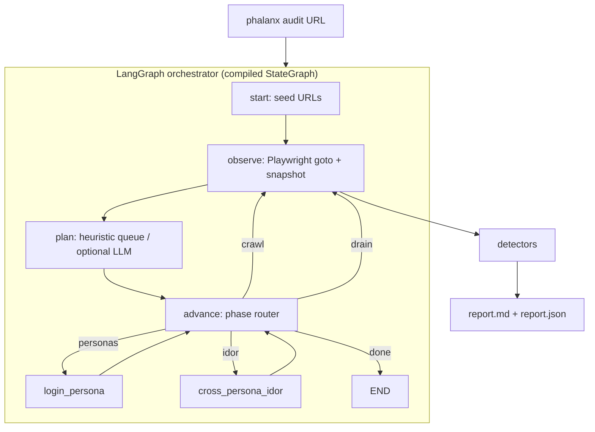

<div align="center">

# Phalanx

### Multi-persona QA & security testing swarm

*Point it at a running app. Get a deduplicated bug report with repro steps.*


</div>

> **Scope of this PR.** Working LangGraph + Playwright agent (compiled graph with conditional phase edges), RideLite **regression** suite (12 planted bugs), generic discovery probes, and measured discovery on **OWASP Juice Shop** (unseen). Full multi-persona swarm / tree-sitter preflight from [`docs/ARCHITECTURE.md`](docs/ARCHITECTURE.md) remains roadmap.

---

## Architecture



`run_audit()` invokes the **compiled** graph (`graph.invoke`). Playwright session is held outside state by `run_id` so LangGraph copies do not drop the browser.

---

## Results

### 1) RideLite regression suite (NOT discovery)

Command: `python -m phalanx.cli benchmark --mode heuristic`

The default / `heuristic` / `regression` mode **seeds targeted URLs and payloads** that exercise every planted bug class in `demo_app/` (see `# B1`… comments in `phalanx/graph.py`). Scoring still uses `planted_bugs.json` only in the scorer — but the agent is steered at those classes. **Treat 12/12 as a regression harness, not a claim of novel discovery.**

| Metric | Heuristic / regression |
|---|---|
| Bugs found / planted | **12 / 12** |
| Precision / Recall / F1 | **1.00 / 1.00 / 1.00** |
| Stability | **20 / 20** consecutive runs passed (see `benchmarks/published/stability_20.json`) |

### 2) Discovery on OWASP Juice Shop (unseen)

Target: Juice Shop v17.3.0 on `http://127.0.0.1:3000` (prebuilt linux tarball; not Docker).  
Ground truth: 8 in-scope documented issues in [`benchmarks/juice_shop/ground_truth.json`](benchmarks/juice_shop/ground_truth.json).  
Mode `generic` / `llm` uses **non-targeted** seeds (common paths, form/API fuzzing, login SQLi probe) — no RideLite planted-bug URLs.

| Mode | Found / GT | Precision | Recall | F1 | Model |
|---|---|---|---|---|---|
| **generic** | **6 / 8** | **1.00** | **0.75** | **0.86** | n/a |
| **llm** | **6 / 8** | **1.00** | **0.75** | **0.86** | qwen2.5:1.5b via llama.cpp (`LLM_BASE_URL=http://127.0.0.1:11434/v1`) |

True positives (both modes): `misconfig:directory-listing`, `misconfig:backup-file`, `misconfig:metrics`, `sqli:error-page`, `sqli:login`, `authz:admin-config`.  
Missed: `xss:dom-search` (Angular DOM XSS), `authz:admin-section` (SPA admin route) — expected with HTTP/API-centric probes.  
LLM planner (1.5B) suggested a few extra paths but **did not improve** recall over generic on this GT set — reported as-is.

Reproduce:

```bash
# terminal A — Juice Shop (example)
cd /path/to/juice-shop && npm start -- --port 3000

# terminal B
python benchmarks/run_discovery.py --url http://127.0.0.1:3000 --mode generic
LLM_BASE_URL=http://127.0.0.1:11434/v1 LLM_MODEL=qwen2.5:1.5b \
  python benchmarks/run_discovery.py --url http://127.0.0.1:3000 --mode llm
```

---

## CI

OAuth token lacks `workflow` scope → copy [`ci/github-actions.yml`](ci/github-actions.yml) to `.github/workflows/ci.yml`. Smoke test retries once on Playwright flakes.

```bash
pytest -q tests/
```

---

## Quickstart

```bash
python -m venv .venv && source .venv/bin/activate
pip install -r requirements.txt
python -m playwright install chromium

pytest -q tests/test_detectors.py tests/test_demo_app.py
python -m phalanx.cli benchmark --mode heuristic   # RideLite regression
python -m phalanx.cli audit http://127.0.0.1:3000 --mode generic
```

---

## Tech stack

LangGraph · Playwright · Flask (RideLite) · pytest · optional OpenAI-compatible LLM (llama.cpp / Ollama)

## License

MIT.
