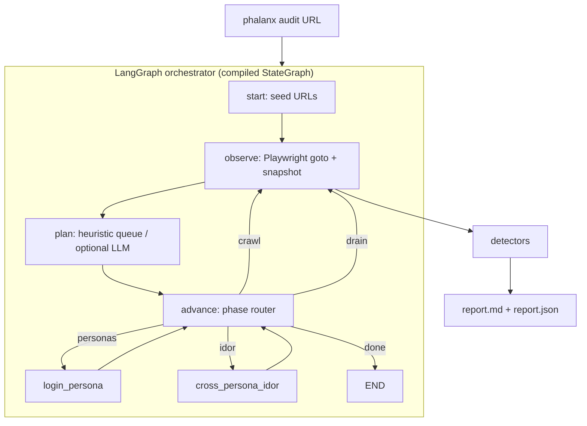

<div align="center">

# Phalanx

### Multi-persona QA & security testing swarm

*Point it at a running app. Get a deduplicated bug report with repro steps.*


</div>

> **Scope of this PR.** Working LangGraph + Playwright agent (compiled graph with conditional phase edges), RideLite **regression** suite (12 planted bugs), generic discovery probes, and measured discovery on **OWASP Juice Shop** (unseen). Full multi-persona swarm / tree-sitter preflight from [`docs/ARCHITECTURE.md`](docs/ARCHITECTURE.md) remains roadmap.

---

## Architecture



`run_audit()` invokes the **compiled** graph (`graph.invoke`). Playwright session is held outside state by `run_id` so LangGraph copies do not drop the browser.

---

## Results

### 1) RideLite regression suite (NOT discovery)

Command: `python -m phalanx.cli benchmark --mode heuristic`

The default / `heuristic` / `regression` mode **seeds targeted URLs and payloads** that exercise every planted bug class in `demo_app/` (see `# B1`… comments in `phalanx/graph.py`). Scoring still uses `planted_bugs.json` only in the scorer — but the agent is steered at those classes. **Treat 12/12 as a regression harness, not a claim of novel discovery.**

| Metric | Heuristic / regression |
|---|---|
| Bugs found / planted | **12 / 12** |
| Precision / Recall / F1 | **1.00 / 1.00 / 1.00** |
| Stability | **20 / 20** consecutive runs passed (see `benchmarks/published/stability_20.json`) |

### 2) Discovery on OWASP Juice Shop (unseen app)

Target: Juice Shop **v17.3.0** on `http://127.0.0.1:3000` (prebuilt linux tarball; not Docker).

**Scoring is against the official challenge list**, not a hand-written key:
[`benchmarks/juice_shop/official_challenges.json`](benchmarks/juice_shop/official_challenges.json)
is taken from Juice Shop's own `/api/Challenges` / `data/static/challenges.yml`, scoped to the
**10 challenges a black-box, unauthenticated crawler can reach in one step** (no CAPTCHA / coupon
math / authenticated multi-step puzzles). Each challenge lists the finding fingerprint(s) that count
as a hit, so scoring is auditable.

Generic mode uses **only** the app-agnostic wordlist
[`benchmarks/wordlists/common_paths.txt`](benchmarks/wordlists/common_paths.txt)
(sourced from SecLists `common.txt` / `raft-small-words` + OWASP WSTG sensitive-file checks) plus
generic SQLi/XSS payload families applied to forms and query params the crawl discovers. **No
target-specific paths or payloads.** (An earlier version of this benchmark hard-coded Juice Shop
paths like `/ftp/*.bak` and `/rest/admin/application-configuration` and scored 6/8 against a
hand-written key — that was overfitting and has been removed.)

| Mode | Official scoped found | Precision | Recall | F1 | Model |
|---|---|---|---|---|---|
| **generic** | **1 / 10** | **1.00** | **0.10** | **0.18** | n/a |
| **llm** | **1 / 10** | **1.00** | **0.10** | **0.18** | qwen2.5:1.5b via llama.cpp |

Both modes (at equal 80-step budget) find only `exposedMetricsChallenge` — the unauthenticated
`/metrics` endpoint, which happens to be a standard path in the generic wordlist. Everything else is
missed: Juice Shop is an Angular SPA whose vulnerable surface lives behind JS routes (`/#/…`) and
non-standard API paths (`/rest/user/login`, `/rest/products/search`, `/ftp`) that an app-agnostic
crawler does not know and cannot discover from the static HTML. The 1.5B LLM planner did not help.

**Honest takeaway:** against an unseen SPA, this crawler's black-box discovery is weak (recall 0.10).
The strength of the project is the **regression harness** (section 1), not zero-knowledge discovery.
See the resume guidance at the bottom of this section.

Reproduce:

```bash
# terminal A — Juice Shop
cd /path/to/juice-shop && npm start -- --port 3000
# terminal B
python benchmarks/run_discovery.py --url http://127.0.0.1:3000 --mode generic --max-steps 80
LLM_BASE_URL=http://127.0.0.1:11434/v1 LLM_MODEL=qwen2.5:1.5b   python benchmarks/run_discovery.py --url http://127.0.0.1:3000 --mode llm --max-steps 80
```

**Resume guidance:** lead with the measured RideLite **regression** result and the engineering
(compiled LangGraph graph, nav-stable Playwright, 20/20 reproducibility). Do **not** put a Juice Shop
"discovery" number on a resume — recall is only 0.10 and would not survive scrutiny.

---

## CI

OAuth token lacks `workflow` scope → copy [`ci/github-actions.yml`](ci/github-actions.yml) to `.github/workflows/ci.yml`. Smoke test retries once on Playwright flakes.

```bash
pytest -q tests/
```

---

## Quickstart

```bash
python -m venv .venv && source .venv/bin/activate
pip install -r requirements.txt
python -m playwright install chromium

pytest -q tests/test_detectors.py tests/test_demo_app.py
python -m phalanx.cli benchmark --mode heuristic   # RideLite regression
python -m phalanx.cli audit http://127.0.0.1:3000 --mode generic
```

---

## Tech stack

LangGraph · Playwright · Flask (RideLite) · pytest · optional OpenAI-compatible LLM (llama.cpp / Ollama)

## License

MIT.
