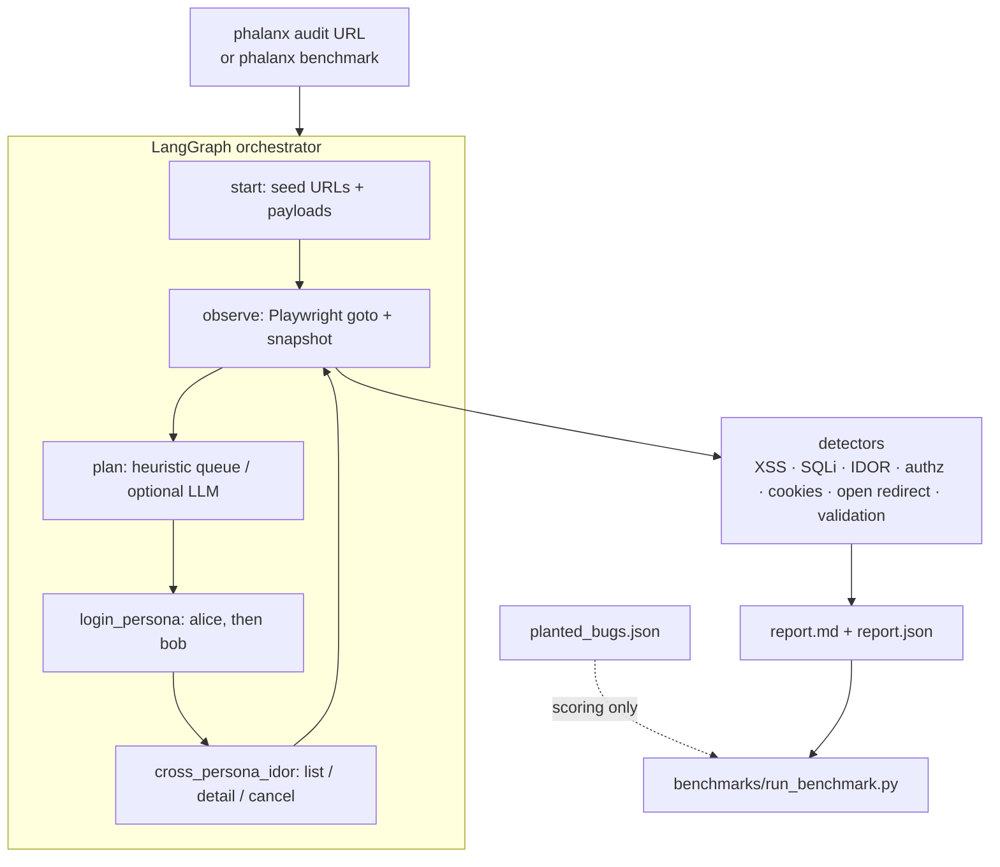

<div align="center">

# Phalanx

### Multi-persona QA & security testing swarm

*Point it at a running app. Get a deduplicated bug report with repro steps.*


</div>

> **Scope of this PR.** The original Phalanx write-up was a concept (HTML prototype + docs). This branch ships a **working LangGraph + Playwright agent loop**, a deliberately buggy demo app with 12 planted bugs, a reproducible benchmark, pytest + GitHub Actions CI, and measured results. The full multi-persona swarm / tree-sitter preflight / cost-tiered BYOM stack from [`docs/ARCHITECTURE.md`](docs/ARCHITECTURE.md) remains the roadmap — not claimed as shipping here.

---

## Problem

Pre-ship QA misses the bugs that need **two users at once**: IDOR, cancel-someone-else's-resource, permission leaks, racey state. Scripted Playwright suites don't invent those scenarios; single-agent AI QA rarely switches persona mid-run. Phalanx's MVP closes that gap with a small, inspectable loop:

1. Crawl + probe a target with Playwright (a11y-visible pages, forms, cookies, API GETs).
2. Switch personas (alice → bob) and re-hit the same resources.
3. Dedup findings by fingerprint and emit a Markdown/JSON report with repro steps.

---

## Architecture



**Design decisions / trade-offs**

| Decision | Why | Trade-off |
|---|---|---|
| Heuristic detectors as the default mode | Benchmark must run in CI with no API key and be deterministic | Does not invent novel bug classes; LLM mode is opt-in |
| Planted-bug demo app (`demo_app/`) instead of a live SaaS | Reproducible recall/precision; no ToS / auth / flakes | Scores are on an app the detectors know how to probe — reported honestly below |
| Fingerprint-based dedup | Same bug hit by alice and bob collapses to one finding | Over-aggressive fingerprints can hide variants |
| Sync Playwright inside LangGraph nodes | Simpler debugging than async for an MVP | Throughput capped vs a true parallel swarm (roadmap) |
| BYOM via `LLM_*` env (OpenAI-compatible) | Ollama / Groq / OpenRouter / OpenAI all work | LLM suggestions are best-effort; heuristic probes still drive coverage |

---

## Results (measured on this machine)

Command:

```bash
python -m phalanx.cli benchmark --mode heuristic
```

Target: `demo_app/` (RideLite) with **12 planted bugs** listed in `demo_app/planted_bugs.json`.
The agent process never reads that file; only the scorer does.

| Metric | Heuristic mode (CI / default) |
|---|---|
| Bugs found / planted | **12 / 12** |
| Precision | **1.00** |
| Recall | **1.00** |
| F1 | **1.00** |
| Steps / URLs visited | 16 / 16 |
| False positives | 0 |
| False negatives | 0 |

True positives matched by fingerprint: `404:/help`, `authz:admin-open`, `secrets:plaintext-passwords`, `xss:estimate`, `sqli:search`, `idor:rides-list`, `idor:ride-detail`, `idor:cancel`, `idor:api-ride`, `validation:negative-tip`, `open-redirect:profile`, `cookie:no-httponly`.

**How to read this.** Perfect scores mean the heuristic probes cover every planted bug class in RideLite. That is the right goal for a regression harness; it is **not** a claim that Phalanx finds every bug in arbitrary production apps. Treat the number as "benchmark harness works and these 12 classes are covered," then grow the planted set / switch `--mode llm` for exploration.

LLM mode (`--mode llm`, needs `LLM_BASE_URL` / `LLM_API_KEY` / `LLM_MODEL`): the planner asks an OpenAI-compatible model for the next path; heuristic probes still run. Numbers are **TBD** until re-run with a chosen model — set the env vars and:

```bash
LLM_BASE_URL=http://localhost:11434/v1 LLM_API_KEY=ollama LLM_MODEL=qwen2.5:7b \
  python -m phalanx.cli benchmark --mode llm --out benchmarks/results-llm
```

---

## CI

The OAuth token used to open this PR cannot push files under `.github/workflows/` (needs the `workflow` scope). A ready-to-use workflow lives at [`ci/github-actions.yml`](ci/github-actions.yml) — copy it to `.github/workflows/ci.yml` on `main` (or re-push with a PAT that has the `workflow` scope) to enable GitHub Actions.

## Quickstart

```bash
python -m venv .venv && source .venv/bin/activate
pip install -r requirements.txt
python -m playwright install chromium

# 1) unit + demo-app tests (no browser swarm)
pytest -q tests/test_detectors.py tests/test_demo_app.py

# 2) full planted-bug benchmark (starts RideLite, runs agent, scores)
python -m phalanx.cli benchmark --mode heuristic
# → benchmarks/results/benchmark.md

# 3) audit any running app
python demo_app/app.py   # terminal A
python -m phalanx.cli audit http://127.0.0.1:5055 --out reports/ridelite
```

---

## Repository layout

```text
phalanx/           # agent package (graph, browser, detectors, report, cli)
demo_app/          # RideLite — planted-bug target (DO NOT deploy)
benchmarks/        # scorer + measured results
tests/             # pytest (detectors, demo app, benchmark smoke)
docs/              # long-form concept architecture / roadmap / cost analysis
prototype/         # original HTML prototype (kept for history)
```

---

## Tech stack

LangGraph · Playwright · Flask (demo target) · pytest · GitHub Actions · optional OpenAI-compatible LLM (Ollama / Groq / OpenRouter)

---

## License

MIT. Concept docs and the original HTML prototype remain under the same license.
